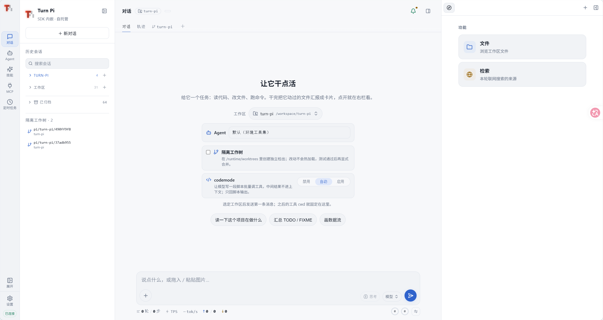

<p align="center">
  <picture>
    <source media="(prefers-color-scheme: dark)" srcset="docs/brand/turnpi-icon-inverse.svg">
    
  </picture>
</p>

<h1 align="center">Turn Pi</h1>

<p align="center"><strong>把 <a href="https://github.com/earendil-works/pi">Pi</a> 编码 agent 做成一个自托管的 web 工作台。</strong></p>

<p align="center">
浏览器里对话、看执行轨迹、审 Git、翻文件；服务端用 Pi 的 SDK 内嵌跑 agent，<br>
一条 <code>docker compose up</code> 就能跑起来，状态全在本地。
</p>

<p align="center">
  <picture>
    <source media="(prefers-color-scheme: dark)" srcset="docs/assets/screenshot-dark.png">
    
  </picture>
</p>

## 它解决什么

命令行里的编码 agent 很好用，但有几件事在终端里做不了：

| 终端里难 | Turn Pi 的做法 |
|---|---|
| 看不清 agent 到底做了什么 | **轨迹**：输入 / 工具 / 思考三轨时间线，每步可展开看耗时、首 token 延迟、上下文占用 |
| 改完不知道动了什么 | **Git tab**：每个仓库一个 tab，提交记录画成分支泳道图，未提交改动单独一条，点提交看改动文件 |
| 想看生成的文件 | **右栏工作台**：文件树 + Markdown / 代码（CodeMirror）/ 图片 / SVG / PDF 预览，点工具行的 ↗ 直接定位 |
| 多轮对话越滚越大 | 上下文环 + 一键压缩；切会话只加载最近 3 轮，上翻按需补 |
| 密钥在会话里裸奔 | **凭据 vault**：AES-256-GCM 加密，agent 只能拿「租约 + loopback 代理」，明文不进会话记录 |
| 一个仓库改一半不敢动 | **隔离 worktree**：新会话可以在 `git worktree` 里跑，`node_modules` 共享而不写穿 |

## 快速开始

需要一个模型 key（默认走 `opencode-go`，也可以换成任何 OpenAI / Anthropic 兼容供应商）。

```bash
git clone https://github.com/895252509/turn-pi.git && cd turn-pi
cp .env.example .env        # 填 OPENCODE_API_KEY
docker compose up -d --build
open http://localhost:44100
```

或者用 Makefile（会先构建前端、再做网段预检）：

```bash
make up        # 构建 + 后台启动
make logs      # 跟随日志
make down
```

首次打开需要一个访问 token：不设置 `PI_ACCESS_TOKEN` 时服务会自动生成并打印在启动日志里，
浏览器访问 `http://localhost:44100/?token=<token>` 完成握手，之后用 Cookie。

不给容器宿主权限：默认**不挂** `/var/run/docker.sock`。确实需要容器里的 agent 操作宿主 docker 时再叠加：

```bash
make up-docker   # = docker compose -f docker-compose.yml -f docker-compose.docker.yml up -d --build
```

> 这是提权：socket 等于宿主 root。单人自用可以，多人或对外部署别开。

### 不用容器

```bash
npm install --include=dev
npm run build:web
node server/index.ts          # 需要 Node >= 22.18（原生跑 TypeScript）
```

## 配置

全部配置都是环境变量或 `.env`，没有配置文件格式要学。常用几个：

| 变量 | 说明 | 默认 |
|---|---|---|
| `OPENCODE_API_KEY` | 模型 key（默认供应商） | — |
| `PI_PROVIDER` / `PI_MODEL` | 供应商 / 模型 | `opencode-go` / `deepseek-v4.1-flash` |
| `PI_WORKSPACE_PATH` | 宿主上给 agent 读写的工作区（compose 挂到 `/workspace`） | `./data/workspace` |
| `PI_TOOLS` | 启用哪些工具 | `read,grep,find,ls,bash,edit,write,codemode` |
| `PI_ACCESS_TOKEN` | 固定访问 token（不填则自动生成） | 自动生成 |
| `PORT` / `HOST` | 监听地址 | `44100` / `0.0.0.0` |
| `PI_RUNTIME_DIR` | 运行态根（凭据、技能库、workspace 注册表、定时任务） | `/runtime` |
| `PI_SESSION_DIR` | 会话历史 | `/sessions` |

联网搜索（`web_search` / `web_fetch`）零配置可用（走 Exa 托管 MCP，query 会发给 Exa）；
想自己掌控就配 `PI_SEARXNG_URL`、`TAVILY_API_KEY`、`BRAVE_API_KEY`、`EXA_API_KEY` 之一。
完整清单见 [`.env.example`](.env.example) 与 [`docs/web-search.md`](docs/web-search.md)。

## 能力

| 模块 | 说明 |
|---|---|
| 对话 | Pi SDK 内嵌；流式输出、思考与工具调用可展开、生成中插话（Enter）与排队（Ctrl/Cmd+Enter） |
| 轨迹 | 三轮道时间线 + 按时间还原执行过程；展开任一步看该步之前的系统提示词 / 工具 schema / 消息上下文 / 原始 provider payload |
| Agent 模板 | 左栏「Agent」：把 `runtime/agents/<id>/CARD.md` 当唯一真相，可视化编辑工具 / 技能 / 系统提示词 / 模型；预览用 **dry-run 会话**读出模型真正会收到的提示词（含 token 估算）；支持 fork 与合并 |
| 技能 | 内容寻址技能库（`runtime/skillstore/<kind>/<name>/<hash>/`）+ 有序组合；左侧「技能」页接入 GitHub 技能市场（Superpowers / OK Skills / GameDev / Anthropic …），可看原文与中文对照、审计后进 prompt；模板只钉引用，注入时现读现验 hash |
| MCP | 平台托管一份 `runtime/mcp.json`，stdio / streamable HTTP 都支持，带连接测试；默认 `exposure=codemode`，工具只在 codemode 脚本里可达，不占工具声明 |
| 凭据 | 加密 vault；scoped 凭据给 agent `cred_list` / `cred_use`，审批后发租约 + loopback 代理，真实密钥由服务端注入；env 层保存后即时生效；带轮换、撤销、审计流水 |
| 多供应商 | 内置 + 自定义供应商卡片；OpenAI / Anthropic / Gemini / OpenRouter / DeepSeek / Kimi / GLM / Groq / xAI 预设；可测连通、拉模型 |
| 额度 | 自动探测余额与订阅额度（OpenCode Go 的 5h / 7d / 30d 窗口、OpenRouter / DeepSeek / Moonshot 余额、`x-ratelimit-*` 头） |
| 工作区 | 新会话选 workspace，注册表在 `runtime/workspaces.json`；`readonly` 工作区会摘掉 `bash/edit/write` |
| worktree | 新会话可开在隔离 worktree 里；共享依赖用符号链接，装依赖会写穿到主工作区时直接拦住 |
| Git | 每个仓库一个 tab：分支泳道图、本地/远端分支筛选、未提交改动、提交详情与改动文件 |
| 右栏 | 文件树（多 root，含只读 `/tmp`）+ Markdown / 代码 / 图片 / SVG / PDF 预览；检索面板按批次列出 `web_search` 来源 |
| 定时任务 | 进程内调度器，状态落 `runtime/jobs/` |
| codemode | `codemode` 工具让模型写一段 JS 在 QuickJS 沙箱里批量调工具，中间结果不进上下文；脚本内每次工具调用在工具行下实时展开 |

## 架构

```
浏览器 ──HTTP/SSE──▶ server/index.ts ──SDK──▶ createAgentSession()
                          │                     └─ 工具 read/grep/find/ls/bash/edit/write + codemode
                          │                     └─ 自定义工具 cred_list / cred_use / report_files / web_* / read_fetched
                          ├──▶ runtime/skillstore   技能库（内容寻址）
                          ├──▶ runtime/credentials.* 凭据 vault + 租约
                          ├──▶ runtime/workspaces.json · worktrees.json · jobs/
                          └──▶ /sessions            会话历史（Pi 的 JSONL）
```

单进程 Node（`node --watch` 热重启 `server/`），没有数据库——状态全是文件，可 `git diff`、可备份、可 `rsync`。
前端是 React 19 + Vite + Tailwind（`tw-` 前缀），构建产物 `web/dist` 由同一个进程静态托管。

```
server/        HTTP 路由、Chat 装配、工具实现、各子系统（凭据/技能/Git/worktree/MCP/搜索/调度）
web/src/       React 前端：store 用 zustand，SSE 单一数据源
runtime/       agents/*/CARD.md（Agent 模板）、skillstore/、凭据索引与审计
docs/          设计与接口说明
scripts/       自检脚本（语法、路由、各模块 smoke）
```

## 自检

仓库里每个模块都有自己的检查脚本，改完先跑它们比等线上 502 快：

```bash
make check          # server 语法（Node 自带 TS 解析器）+ 联网搜索/抓取离线回归
make check-web      # 前端 tsc + 构建 + happy-dom 冒烟（不需要浏览器）
npm run check:agent-card    # Agent 模板：CARD 校验
npm run check:agent-spec    # AgentSpec 组装
npm run check:mcp           # MCP 管理 API（会去连服务器，离线环境请加超时）
npm run check:git-panel     # Git tab 数据装配
npm run check:worktree-deps # worktree 依赖共享
```

## 已知限制

诚实清单，都是为了先跑通而留的：

- **单用户**：一个访问 token、所有会话共享一个运行态。没有多用户、没有 RBAC、没有按人隔离的会话。
- **「域（domain）」目前只是标签**：设置页可以填，会存进会话，但还没有基于它的分组或权限。
- **没有数据库**：状态都是文件，单进程内串行写。要横向扩就得先换掉这一层。
- **中文界面**：UI 与文档目前是中文，没有 i18n。
- **移动端**：能看能发，但右栏与 Git 图在窄屏是降级体验。
- **容器内 docker 是提权选项**，默认关闭；打开等于把宿主 root 交给 agent。

## 文档

| 文档 | 内容 |
|---|---|
| [`docs/mcp.md`](docs/mcp.md) | MCP 接入与管理面 |
| [`docs/web-search.md`](docs/web-search.md) | `web_search` / `web_fetch` 的降级链与出站策略 |
| [`docs/credential-manager.md`](docs/credential-manager.md) | 凭据 vault、租约、代理与审计 |
| [`docs/skills-integration.md`](docs/skills-integration.md) | 技能库：内容寻址、组合、模板钉引用 |
| [`docs/agent-templates.md`](docs/agent-templates.md) | Agent 模板（CARD）格式与 fork / 合并 |
| [`docs/workspace-and-worktree.md`](docs/workspace-and-worktree.md) | workspace 注册表与隔离 worktree |
| [`docs/worktree-deps.md`](docs/worktree-deps.md) | worktree 共享依赖（符号链接 + 安装拦截） |
| [`docs/git-panel.md`](docs/git-panel.md) | Git tab：分支泳道、提交详情 |
| [`docs/input-triggers.md`](docs/input-triggers.md) | 输入框 `/` 命令与 `@` 会话引用 |
| [`docs/turn-file-cards.md`](docs/turn-file-cards.md) | 轮末文件汇报卡片与 `pi-resource://` |
| [`docs/app-shell.md`](docs/app-shell.md) | 应用外壳：三栏、上下文列、断点 |
| [`docs/brand/`](docs/brand/) | 图标与品牌资源 |

## 参与

- [`CONTRIBUTING.md`](CONTRIBUTING.md)：开发约定、提 PR 前要跑的自检
- [`SECURITY.md`](SECURITY.md)：威胁模型（哪些不是漏洞、哪些是）与私密报告渠道
- [`CODE_OF_CONDUCT.md`](CODE_OF_CONDUCT.md)：行为准则

## 许可

[MIT](LICENSE)。依赖的 `@earendil-works/pi-coding-agent` 也是 MIT。
